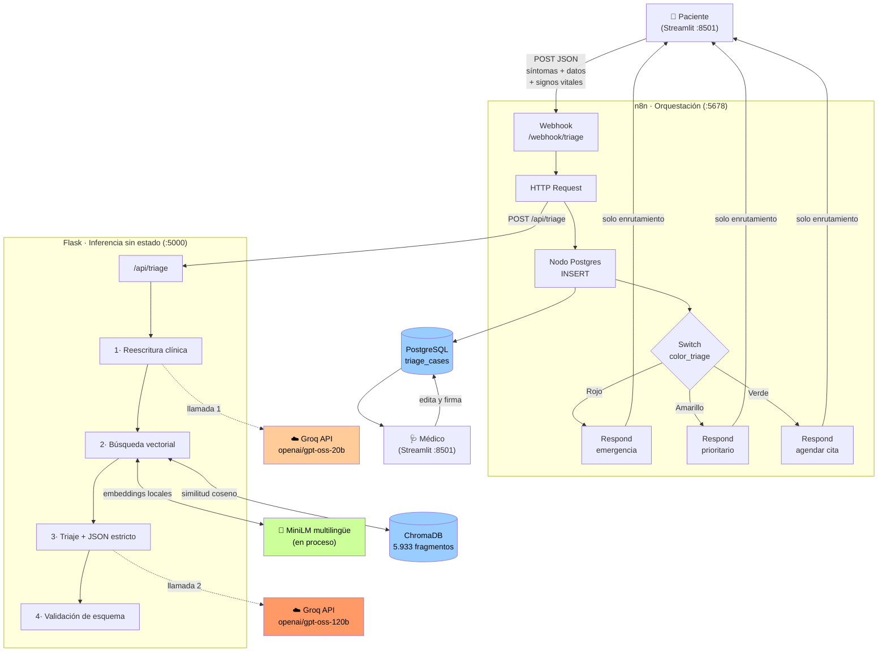

<style>
/* Estilos de impresión embebidos. Van dentro del documento a propósito: la extensión
   de exportación solo carga docs/pdf.css si el proyecto es la carpeta raíz abierta en
   el editor, y así el PDF sale correcto en cualquier caso. */
body { font-family: "Segoe UI", "Helvetica Neue", Arial, sans-serif; font-size: 10.5pt;
       line-height: 1.6; color: #1e293b; }
.page-break, div[style*="page-break-after"] { page-break-after: always !important;
       break-after: page !important; height: 0; }
h1 { font-size: 20pt; color: #0f172a; letter-spacing: -0.02em; margin-bottom: 0.3em; }
h2 { font-size: 15pt; color: #0f172a; border-bottom: 1.5px solid #cbd5e1;
     padding-bottom: 0.25em; margin-top: 1.6em; page-break-after: avoid; }
h3 { font-size: 12pt; color: #0f766e; margin-top: 1.3em; page-break-after: avoid; }
h4 { font-size: 10.5pt; color: #334155; page-break-after: avoid; }
table { border-collapse: collapse; width: 100%; font-size: 9.5pt; margin: 1em 0;
        page-break-inside: avoid; }
th { background: #f1f5f9; color: #0f172a; font-weight: 600; text-align: left;
     border: 1px solid #cbd5e1; padding: 6px 9px; }
td { border: 1px solid #e2e8f0; padding: 6px 9px; vertical-align: top; }
tr:nth-child(even) td { background: #f8fafc; }
pre { background: #f8fafc; border: 1px solid #e2e8f0; border-radius: 4px; padding: 10px 12px;
      font-size: 8pt; line-height: 1.35; page-break-inside: avoid; white-space: pre;
      overflow-x: hidden; }
code { font-family: "Cascadia Code", Consolas, monospace; font-size: 9pt; background: #f1f5f9;
       padding: 1px 4px; border-radius: 3px; }
pre code { background: none; padding: 0; font-size: inherit; }
blockquote { border-left: 3px solid #0f766e; background: #f0fdfa; margin: 1em 0;
             padding: 0.6em 1em; color: #334155; }
div[align="center"] h1 { font-size: 24pt; margin-top: 0; }
div[align="center"] h3 { font-size: 12pt; font-weight: 400; color: #475569; }
hr { border: none; border-top: 1px solid #e2e8f0; margin: 1.6em 0; }
strong { color: #0f172a; }
</style>

<div align="center">
<br><br><br>

# Arquitectura de Implementación

### Diagrama de integraciones y flujo de datos entre APIs, modelos, bases de datos y servicios

<br><br>
<br><br>

**Proyecto Final** — Sistema de Triaje Clínico Preliminar

<br><br><br><br>

Artificial Intelligence Essentials (AIE) — Summer Camp 2026

<br><br><br><br><br>

Escuela Politécnica Nacional
Célula de Ciberseguridad CyberMinds

<br><br><br><br>

**Autor:** `Vinicio Stalin Salcedo Peña`

<br><br><br>

</div>

<div class="page-break" style="page-break-after: always;"></div>

## 1. Vista general



<br>

---

## 2. Servicios y responsabilidades

| Servicio | Imagen | Puerto | Responsabilidad | Estado |
|---|---|---|---|---|
| `frontend` | build local | 8501 | Captura del paciente y panel del médico | Sin estado |
| `n8n` | `n8nio/n8n` | 5678 | Orquestación, persistencia y enrutamiento | Workflows en volumen |
| `backend` | build local | 5000 | Reescritura, recuperación e inferencia | **Sin estado** |
| `postgres` | `postgres:16-alpine` | 5433→5432 | Historial y estados de atención | Volumen persistente |

**Servicios externos:** Groq Cloud (única dependencia de red saliente). Los embeddings se
calculan localmente dentro del contenedor `backend`; el corpus nunca sale de la máquina.

### Separación deliberada de responsabilidades

Flask **no escribe en la base de datos**. Es un motor de inferencia puro: recibe síntomas,
devuelve un JSON, no produce efectos secundarios. Quien persiste es el nodo Postgres de
n8n. El único acceso de escritura del backend a la base es el registro de la firma médica,
invocado desde el panel del médico.

Esto tiene tres consecuencias prácticas: el endpoint es idempotente y se puede probar sin
ensuciar el historial; la orquestación es visible como un flujo, no enterrada en código; y
el esquema no depende de que Flask haya arrancado, porque se crea al levantar la base
(`db/init.sql` montado en `docker-entrypoint-initdb.d`).

### Red interna

Los contenedores se resuelven por nombre de servicio dentro de la red de Docker Compose:
n8n llama a `http://backend:5000`, el backend y el frontend a `postgres:5432`. El puerto
`5433` publicado hacia el host existe solo para inspección externa, porque la máquina de
desarrollo ya tiene un PostgreSQL nativo ocupando el 5432.

---

<div class="page-break" style="page-break-after: always;"></div>

## 3. Flujo de datos, paso a paso

### Etapa 1 — Captura

```json
POST /webhook/triage
{
  "symptoms": "Se me hincharon la cara y las manos de un día para otro,
               me duele muchísimo la cabeza y veo lucecitas",
  "edad": 28, "sexo": "femenino", "gestante": true,
  "pa_sistolica": 168, "pa_diastolica": 112, "frecuencia_cardiaca": 92
}
```

Todos los campos salvo `symptoms` son opcionales; el triaje funciona sin ellos, pero reducen la incertidumbre que de otro modo fuerza el escalamiento conservador.

Los signos vitales admitidos son presión arterial sistólica y diastólica, frecuencias cardíaca y respiratoria, temperatura y saturación de oxígeno. Llegan al modelo **como dato en el prompt, nunca como condición en el código**: `_parse_vitals` valida que un valor sea numérico y nada más. Decidir si una cifra es alarmante corresponde a la inferencia contrastada con las guías; un umbral codificado en Python convertiría la clasificación de gravedad en la regla fija que este proyecto descarta.

### Etapa 2 — Reescritura clínica (Groq, llamada 1)

El relato coloquial se traduce a terminología de guía:

```
"edema facial y de manos de instauración brusca en gestante, cefalea intensa,
 escotomas centelleantes, preeclampsia con signos de gravedad,
 hipertensión gestacional, eclampsia inminente, síndrome HELLP"
```

**Por qué existe esta etapa.** Buscar con las palabras del paciente contra texto técnico
recuperaba secciones equivocadas: "hinchazón de cara + cefalea + alteración visual" se
parece más a la sección de envenenamientos que al lenguaje de la guía obstétrica. El
incidente completo está documentado en el anexo de trazabilidad del copiloto.

La salida se valida antes de usarse: si viene vacía, es demasiado corta o contiene marcas
de rechazo —lo que ocurre ante intentos de inyección de prompt—, se descarta y se continúa
solo con el texto original.

### Etapa 3 — Recuperación semántica

Se consulta **dos veces** —con el texto original y con la traducción clínica— y se
fusionan los resultados, conservando la menor distancia por fragmento. Cada consulta acierta
en casos distintos: el relato original preserva matices, la traducción alcanza secciones
que el lenguaje coloquial nunca recuperaría.

| Parámetro | Valor | Justificación |
|---|---|---|
| Modelo | `paraphrase-multilingual-MiniLM-L12-v2` | El corpus y las consultas son en español |
| Métrica | Coseno | Rango acotado [0,2], umbral interpretable |
| Fragmento | 500 car. / 100 de solapamiento | Ajustado a la ventana efectiva del modelo |
| `k` | 4 por consulta | Contexto suficiente sin diluir el prompt |
| `MAX_DISTANCE` | 0,65 | Calibrado empíricamente; filtro de dominio, no de relevancia (ver `rag/config.py`) |

Los fragmentos que superan el umbral se descartan. **Si ninguno lo supera, se entrega
contexto vacío**, y tanto el prompt como el panel del médico lo declaran. Es preferible
admitir la ausencia de respaldo normativo a citar el fragmento menos malo.

### Etapa 4 — Inferencia de triaje (Groq, llamada 2)

Se envía el relato, los datos del paciente y los fragmentos recuperados con su procedencia
(guía y página). El modelo responde con `response_format: json_object` —JSON mode nativo,
no confianza en que el prompt se respete.

El prompt instruye explícitamente que **el contexto puede ser irrelevante**: si un fragmento
menciona una causa que el paciente no refirió, debe descartarlo y declararlo, en lugar de
construir el diagnóstico sobre él.

### Etapa 5 — Validación de esquema

Antes de devolver nada se verifica que la respuesta sea JSON parseable, que contenga las
seis claves esperadas y que `color_triage` sea uno de los tres valores admitidos. Si algo
falla se responde `502` con el detalle, en vez de propagar una salida malformada.

```json
{
  "color_triage": "Rojo",
  "diagnostico_presuntivo": "Preeclampsia grave con posible evolución a eclampsia",
  "explicacion_feynman": "Usted está embarazada y ha notado que su cara y manos...",
  "propuesta_receta_o_plan": "1. Traslado inmediato a unidad obstétrica...",
  "justificacion_clinica_rag": "Según trastornos_hipertensivos_embarazo pág. 19...",
  "contraindicaciones_alertas": "Sulfato de magnesio: contraindicado en...",
  "consulta_clinica": "edema facial y de manos de instauración brusca...",
  "fuentes_rag": [{"guia": "...", "pagina": 19, "distancia": 0.3034}]
}
```

Los dos últimos campos son metadatos de auditoría: permiten reconstruir **por qué** el
sistema llegó a esa conclusión.

### Etapa 6 — Persistencia

El nodo Postgres compone la fila desde dos orígenes: los datos del paciente vienen del nodo
Webhook, el análisis del nodo HTTP Request. La columna `propuesta_ia` guarda la propuesta
del modelo, distinta de `plan_final`, que guardará lo que el médico firme. El `id` lo asigna
la secuencia `SERIAL`.

### Etapa 7 — Enrutamiento

El nodo Switch deriva según `color_triage` hacia tres respuestas distintas:

| Color | Respuesta al paciente |
|---|---|
| Rojo | "Acuda INMEDIATAMENTE al servicio de emergencias. Se notificó al médico de turno." |
| Amarillo | "Permanezca en sala de espera. Será atendido con prioridad." |
| Verde | "Su caso quedó registrado. Agende una cita en el dispensario." |

**Ninguna incluye el diagnóstico.** El paciente recibe la conducta a seguir; la hipótesis
diagnóstica y la propuesta terapéutica van al médico.

Que este enrutamiento sea determinista no contradice la prohibición de lógica condicional:
la *clasificación* es inferencia probabilística del modelo. Lo que el Switch hace es actuar
sobre una decisión ya tomada.

### Etapa 8 — Validación humana

El panel consulta los casos pendientes ordenados por gravedad y, dentro de cada color, por
orden de llegada:

```sql
ORDER BY CASE color_triage
           WHEN 'Rojo' THEN 1 WHEN 'Amarillo' THEN 2 WHEN 'Verde' THEN 3 ELSE 4
         END, created_at ASC
```

El médico ve el análisis completo con sus fuentes, edita la propuesta en un campo de texto
libre y firma. La firma escribe `plan_final`, `attended_by`, `attended_at` y cambia
`estado` a `Atendido`, sacando el caso de la cola.

**La propuesta de la IA nunca se sobrescribe.** `propuesta_ia` y `plan_final` coexisten, de
modo que queda registro de qué propuso el modelo y qué decidió la persona.

---

## 4. Esquema de datos

```
triage_cases
├── id                          SERIAL PRIMARY KEY
│
├── ── entrada del paciente ──
├── symptoms_text               TEXT NOT NULL
├── edad                        INTEGER
├── sexo                        TEXT
├── gestante                    BOOLEAN
├── pa_sistolica                INTEGER        -- signos vitales de recepción,
├── pa_diastolica               INTEGER        -- todos opcionales y sin
├── frecuencia_cardiaca         INTEGER        -- validación de rango: su
├── frecuencia_respiratoria     INTEGER        -- interpretación clínica
├── temperatura                 NUMERIC(4,1)   -- corresponde al modelo
├── saturacion_oxigeno          INTEGER
│
├── ── salida de la IA ──
├── color_triage                TEXT NOT NULL  CHECK (Rojo|Amarillo|Verde)
├── diagnostico_presuntivo      TEXT
├── explicacion_feynman         TEXT
├── propuesta_ia                TEXT
├── justificacion_clinica_rag   TEXT
├── contraindicaciones_alertas  TEXT
├── fuentes_rag                 JSONB          -- auditoría de la recuperación
│
└── ── decisión del médico ──
    ├── plan_final              TEXT
    ├── estado                  TEXT NOT NULL  CHECK (Pendiente|Atendido)
    ├── attended_by             TEXT
    ├── created_at              TIMESTAMPTZ NOT NULL DEFAULT now()
    └── attended_at             TIMESTAMPTZ
```

Las restricciones `CHECK` son defensa en profundidad: la escritura la realiza n8n, fuera
del código de la aplicación, y el motor rechaza un color o un estado inválido aunque la
validación previa fallara.

---

<div class="page-break" style="page-break-after: always;"></div>

## 5. Manejo de fallos

| Fallo | Comportamiento |
|---|---|
| Reescritura clínica falla o es secuestrada | Se descarta y se busca solo con el texto original; queda registrado en el log |
| Ningún fragmento supera el umbral | Contexto vacío; el modelo declara la limitación y el panel la advierte |
| Groq no responde | `502` con la causa; no se persiste nada |
| JSON inválido o claves faltantes | `502` con la respuesta cruda para depuración |
| `color_triage` fuera de los tres valores | `502`; además la restricción `CHECK` lo rechazaría |
| Postgres no disponible al arrancar | `depends_on` con `healthcheck` retiene el arranque hasta que responda |

El principio: **degradar con gracia, pero de forma observable**. Un fallback silencioso en
la etapa de reescritura llegó a ocultar un fallo total de ese componente durante varias
pruebas — el incidente está documentado en el anexo de trazabilidad del copiloto.

---

## 6. Decisiones de infraestructura

**Docker Compose** aísla el proyecto de la máquina de desarrollo, que ejecuta otros
servicios (incluido un PostgreSQL nativo en el 5432, motivo del remapeo al 5433).

**PostgreSQL en vez de SQLite** por dos razones concretas: backend y frontend son procesos
separados con acceso concurrente, escenario para el que el bloqueo por archivo de SQLite no
está pensado; y n8n dispone de nodo nativo de PostgreSQL, mientras que con SQLite habría
que recurrir a un `Execute Command` con un script externo.

**Sin framework de orquestación de LLM.** El sistema usa `pypdf`, `sentence-transformers`,
`chromadb` y el SDK de `groq` directamente. Se evaluó LangChain y se descartó: aportaba una
envoltura sobre cuatro operaciones puntuales a cambio del árbol de dependencias más
inestable del proyecto. El resultado es un build reproducible y un flujo donde cada
operación —vectorizar, buscar, invocar— es visible en el código.

**Caché de modelo en volumen.** El modelo de embeddings (~470 MB) se descarga una vez y
persiste en el volumen `hf_cache`; sin él, cada ejecución efímera volvía a descargarlo.
